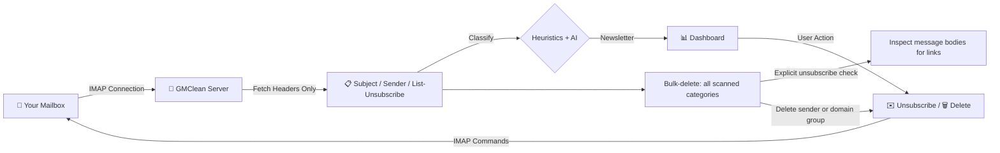

# ✉️ GMClean — Privacy-First Google & Microsoft Email Cleaner

**This fork adds a dedicated Bulk-delete tab: clean up all scanned emails by sender or domain, and check entire groups for unsubscribe links inside email bodies.**

Based on [h-khalid-h/GMClean](https://github.com/h-khalid-h/GMClean), the self-hosted email cleaner for Google, Microsoft, and other IMAP mailboxes.

## What's different in this fork?

| Addition | What it does |
|---|---|
| **Dedicated Bulk-delete tab** | Includes all scanned email categories, even messages missed by newsletter classification. |
| **Optional domain grouping** | Switch from **By sender** (the default) to **By domain** to bundle addresses such as `news@hello.courier` and `offers@hello.courier` under `@hello.courier`. Subdomains stay separate. |
| **Group unsubscribe checks** | **Check unsubscribe** or **Check group unsubscribe** inspects headers and message bodies for actionable unsubscribe links, including localized wording. Domain groups expand to show links per sender. |
| **Better subscription discovery** | Messages with detected unsubscribe links also appear in **Subscriptions**. Body-check results survive subsequent syncs. |
| **Folder-aware deletion** | Deletes a sender or domain group's scanned messages in batches, keeping message IDs scoped to their original folders. |
| **Reliable Trash detection** | Uses the mail server's Trash designation, with fallback support for localized folder names. Safe deletion never silently falls back to permanent deletion. |
| **Search and filters** | Search names, addresses, and domains; filter groups by whether an unsubscribe link has been found. |

**Scope:** Bulk-delete operates on emails already scanned into the app. Scan the folders you want to include in **Overview** first. In domain mode, **Delete all** applies to every sender in that group. Deletion moves messages to Trash by default; permanent deletion requires enabling it in Settings and confirming the action.

**Privacy:** Regular sync still fetches headers only. Clicking an unsubscribe check explicitly downloads the selected group's messages to your self-hosted server for inspection. Message bodies are not saved in the browser database; detected links and check timestamps are saved. Checking for links does not automatically unsubscribe you.

The upstream features—including multiple accounts, inbox analytics, exports, and optional AI classification—remain available.


---

## Why GMClean?

Services like **Unroll.me** and **Clean Email** promise inbox cleanup — but at a hidden cost. They [read and sell your email data](https://www.nytimes.com/2017/04/24/technology/personal-data-firm-slice-unroll-me-privacy-concerns.html), harvest purchase receipts, and build ad profiles from your private messages.

**GMClean is the zero-knowledge alternative.**

- 🚫 No cloud database — your data never leaves your machine
- 📨 Headers-only regular sync; message bodies are fetched only for explicit unsubscribe checks
- 🚫 No telemetry — zero tracking, zero analytics, zero data collection
- ✅ 100% self-hosted — runs entirely on your computer
- ✅ Open source — audit every line of code yourself

---

## Features

| | Feature | Description |
|---|---|---|
| 🔒 | **Privacy-First Scanning** | Headers-only regular sync; optional body inspection for unsubscribe checks |
| 👥 | **Multi-Account** | Connect up to 10 mailboxes (Gmail, Outlook, custom IMAP) simultaneously |
| 📊 | **Inbox Health Score** | 0-100 hygiene score with 5 weighted factors and actionable recommendations |
| 📈 | **Sender Insights** | Trend arrows, frequency, and last activity for every top sender |
| 📅 | **Email Age Distribution** | Color-coded age breakdown to identify cleanup opportunities |
| 📊 | **Inbox Analytics** | Interactive donut charts, top senders, newsletter-to-personal ratio |
| 📁 | **Multi-Folder Scanning** | INBOX, Spam, Promotions, Trash — any IMAP folder |
| ☑️ | **Multi-Select & Bulk Actions** | Select individual senders or Select All with a floating action bar |
| ✉️ | **One-Click Unsubscribe** | RFC 8058 compliant `List-Unsubscribe-Post` support |
| 🚫 | **Bulk Unsubscribe** | Unsubscribe from multiple senders at once with progress tracking |
| 🗑️ | **Bulk Delete** | Dedicated tab for all scanned categories, grouped by sender or domain; folder-aware batches of 500 |
| 🔎 | **Group Unsubscribe Check** | Find links in headers and bodies for an entire sender or domain group |
| 📤 | **Export Subscriptions** | Export selected senders to CSV with resubscribe links |
| 📥 | **Full Email Export** | Export all scanned emails to CSV for offline review |
| 🤖 | **AI Smart Boost** | Optional Gemini-powered classification for edge cases |
| 🛡️ | **Unsubscribe Tracking** | Detects senders who ignore your unsubscribe request |
| ⚡ | **Quick Clean** | One-click cleanup of stale senders from Health Score recommendations |
| 🔑 | **Flexible Auth** | App Password + OAuth2 (Google, Microsoft) |
| 📱 | **Responsive Design** | Fully functional on desktop, tablet, and mobile |
| 💾 | **100% Local Storage** | All data stored in IndexedDB — nothing in the cloud |

---

## Quick Start

### Option 1: npm (Development)

```bash
git clone --branch feature/bulk-delete https://github.com/kleingeldbaron/GMClean.git
cd GMClean
npm install
cp .env.example .env.local
# Edit .env.local with your ENCRYPTION_SECRET
npm run dev
```

Open [http://localhost:3000](http://localhost:3000)

### Option 2: Docker

Build from this fork's source to include its additions. The upstream prebuilt image does not include these changes.

```bash
git clone --branch feature/bulk-delete https://github.com/kleingeldbaron/GMClean.git
cd GMClean
docker build -t gmclean-fork .
docker run -p 3000:3000 \
  -e ENCRYPTION_SECRET=$(openssl rand -base64 32) \
  gmclean-fork
```

### Option 3: Docker Compose

```bash
git clone --branch feature/bulk-delete https://github.com/kleingeldbaron/GMClean.git
cd GMClean
cp .env.example .env.local
# Edit .env.local with your ENCRYPTION_SECRET
docker compose up -d
```

---

## Configuration

Copy `.env.example` to `.env.local` and configure:

| Variable | Required | Description |
|---|---|---|
| `ENCRYPTION_SECRET` | ✅ Yes | AES-256 key for credential encryption. Generate with `openssl rand -base64 32` |
| `GOOGLE_CLIENT_ID` | Optional | Google OAuth2 client ID for one-click Gmail login |
| `GOOGLE_CLIENT_SECRET` | Optional | Google OAuth2 client secret |
| `MICROSOFT_CLIENT_ID` | Optional | Microsoft OAuth2 client ID for Outlook login |
| `MICROSOFT_CLIENT_SECRET` | Optional | Microsoft OAuth2 client secret |

### App Password Setup

For quick setup without OAuth, use an **App Password**:

- **Gmail**: [Google App Passwords](https://myaccount.google.com/apppasswords) (requires 2FA enabled)
- **Outlook**: [Microsoft App Passwords](https://account.live.com/proofs/AppPassword)
- **Yahoo**: [Yahoo App Passwords](https://login.yahoo.com/account/security/app-passwords)
- **Any IMAP server**: Use your mail provider's documentation

---

## How It Works



1. **Connect** via IMAP using an App Password or OAuth2 (up to 10 accounts)
2. **Sync** email headers — subject, sender, and `List-Unsubscribe`
3. **Classify** using heuristic rules + optional Gemini AI for ambiguous cases
4. **Score** your inbox health across 5 hygiene factors (0-100)
5. **Store** results locally in IndexedDB (your browser, your machine)
6. **Act** — manage subscriptions or use **Bulk-delete** to group all scanned emails by sender or domain, check groups for unsubscribe links, and delete them; CSV exports remain available
7. **Switch** between accounts instantly from the sidebar

---

## Privacy

> **Headers-only by default. Message bodies are downloaded only when you explicitly run an unsubscribe check.**

- 📨 Regular sync fetches email **headers** — subject line, sender address, and unsubscribe links
- 🔎 Explicit unsubscribe checks fetch message bodies for server-side inspection; bodies are not stored in IndexedDB
- 🔐 Credentials are encrypted with **AES-256-CBC** before storage
- 💻 Zero cloud dependencies — the entire app runs on **your machine**
- 🚫 No telemetry, no tracking cookies, no analytics scripts
- 🗄️ Scanned metadata, detected links, and check timestamps live in your browser's **IndexedDB** — clear them anytime
- 📖 Fully open source — audit the code yourself

---

## Tech Stack

| Layer | Technology |
|---|---|
| Framework | [Next.js 16](https://nextjs.org/) (App Router) |
| UI | [React 19](https://react.dev/) |
| IMAP Client | [ImapFlow](https://imapflow.com/) |
| Local Storage | [Dexie.js](https://dexie.org/) (IndexedDB wrapper) |
| Icons | [Lucide React](https://lucide.dev/) |
| Styling | Pure CSS (no Tailwind) |
| Language | TypeScript 5 |

---

## Contributing

Contributions are welcome! Here's how to get started:

1. **Fork** the repository
2. **Create** a feature branch: `git checkout -b feature/amazing-feature`
3. **Commit** your changes: `git commit -m 'Add amazing feature'`
4. **Push** to the branch: `git push origin feature/amazing-feature`
5. **Open** a Pull Request

Please make sure your code:
- Passes `npm run lint` with no errors
- Follows the existing code style
- Includes appropriate comments for complex logic

---

## License

This project is licensed under the **MIT License** — see the [LICENSE](LICENSE) file for details.

---

<p align="center">
  <b>Built with ❤️ for people who value their privacy.</b>
</p>
